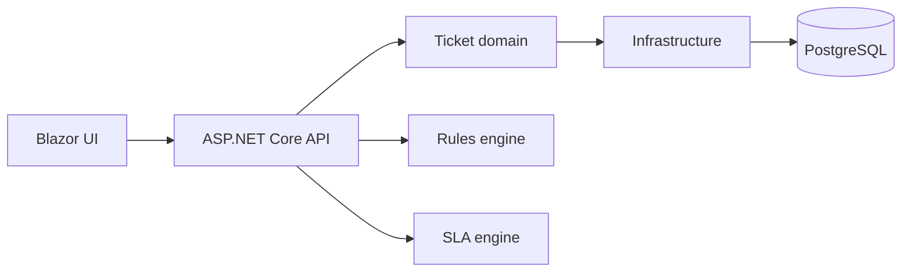

# Helpdesk

> 🚧 **Status: in active development.** The SLA engine is being built first. See the [roadmap](#roadmap) for what works today and what's next.


**A helpdesk where routing is set by rules, SLAs follow real business hours, and you can rebuild any ticket's full history at any point in time.**

Most ticketing systems are forms on top of a database. This project focuses on the parts that are actually hard:

- **SLA engine:** works out deadlines in *working* time, accounting for business hours, weekends, public holidays and paused tickets.
- **Routing rules language:** a small custom language for auto-assigning tickets, with its own lexer, parser and evaluator.
- **Event-sourced tickets:** every change is stored as an event, so the complete history of any ticket can be replayed.

---

## Contents

- [Features](#features)
- [Architecture](#architecture)
- [Tech stack](#tech-stack)
- [Getting started](#getting-started)
- [Project structure](#project-structure)
- [Roadmap](#roadmap)
- [Process](#process)
- [Design decisions](#design-decisions)
- [License](#license)

---

## Features

### ⏱️ SLA engine — *in progress*

Calculates response and resolution deadlines in working hours only.

- Configurable business hours (e.g. Mon–Fri, 08:00–17:00)
- Public holidays calculated by rules: fixed dates, and Easter-based dates such as Good Friday
- The clock pauses on configurable statuses (e.g. *Waiting on customer*)
- Separate **response** and **resolution** timers per priority
- Each timer reports one of four states: **On track**, **At risk**, **Breached** or **Met**

> A High-priority ticket (8 working hours) opened **Friday 15:00**, with Monday a public holiday, is due **Tuesday 14:00**.

```csharp
var calendar = new BusinessCalendar(schedule, MaltaHolidays.Rules, "Europe/Malta");
var result   = evaluator.Evaluate(ticketTimeline, policy, now);

result.Resolution.Due;        // 2026-10-27 14:00
result.Resolution.Remaining;  // 03:20:00
result.Resolution.State;      // SlaState.OnTrack
```

### 🔀 Routing rules language — *planned*

Admins write rules in plain text instead of hardcoding them:

```
when category == "Hardware" and site in ["Valletta", "Gozo"]
then assign team "Field" priority High
```

- Hand-written lexer and recursive-descent parser
- Errors report line and column numbers
- Rules are evaluated automatically when a ticket is created

### 🎫 Ticket management — *planned*

- Requester, Agent and Admin roles
- Create, assign, comment, change status and resolve
- Ticket list with SLA badges ("Due in 3h 20m", "Breached")

### 📜 Event-sourced history — *planned (v2)*

- Every change is stored as an event (`TicketOpened`, `Assigned`, `StatusChanged`, …)
- A full audit timeline on every ticket
- Time travel: `GET /tickets/42?asOf=2026-10-01T09:00`

---

## Architecture



The **SLA engine** and **rules engine** are standalone libraries with no dependencies on the web app or database. They are pure logic, fully unit-tested, and could be reused in any .NET project.

---

## Tech stack

| Area | Technology |
|---|---|
| Language | C# |
| Runtime | .NET 10 (LTS) |
| Web API | ASP.NET Core |
| UI | Blazor |
| Database | PostgreSQL via EF Core (Npgsql) |
| Auth | ASP.NET Core Identity |
| Testing | xUnit, Testcontainers |
| CI | GitHub Actions |
| Local environment | Docker Compose |

---

## Getting started

### Prerequisites

- [.NET 10 SDK](https://dotnet.microsoft.com/download)
- Git
- Docker *(needed once the web app is added)*

### Run the tests

```bash
git clone https://github.com/<your-username>/helpdesk.git
cd helpdesk
dotnet test
```

### Run the app

*Coming in milestone 3.* This will be a single command:

```bash
docker compose up
```

---

## Project structure

```
helpdesk/
├── src/
│   ├── Helpdesk.Sla/             # SLA engine (business calendar, timers)
│   ├── Helpdesk.Rules/           # Routing rules language          (planned)
│   ├── Helpdesk.Domain/          # Ticket model                    (planned)
│   ├── Helpdesk.Infrastructure/  # Database, persistence           (planned)
│   ├── Helpdesk.Api/             # ASP.NET Core API                (planned)
│   └── Helpdesk.Web/             # Blazor UI                       (planned)
├── tests/
│   └── Helpdesk.Sla.Tests/
├── docs/
│   ├── PLAN.md                   # Detailed plan for the current milestone
│   └── decisions/                # Architecture decision records
├── .github/workflows/ci.yml
└── README.md
```

---

## Roadmap

### Milestone 1 — SLA engine 🚧
- [ ] Project setup and CI
- [ ] Holiday rules (fixed dates and Easter-based dates)
- [ ] Business calendar: working time between two dates, adding working time
- [ ] Response and resolution timers
- [ ] Pausing on configurable statuses
- [ ] On track / At risk / Breached / Met states

### Milestone 2 — Routing rules language
- [ ] Lexer
- [ ] Parser and syntax tree
- [ ] Evaluator
- [ ] Error messages with line and column numbers

### Milestone 3 — Web app
- [ ] Database and ticket model (EF Core + PostgreSQL)
- [ ] REST API
- [ ] Login and roles
- [ ] Blazor UI: ticket list, ticket detail, SLA badges
- [ ] SLA engine and rules engine connected to ticket creation
- [ ] Docker Compose setup

### Milestone 4 — Event sourcing (v2)
- [ ] Ticket history stored as events
- [ ] Read-model projections
- [ ] Timeline view and `asOf` queries
- [ ] Write-up: migrating from CRUD to event sourcing

### Stretch goals
- [ ] Email-to-ticket
- [ ] Live updates with SignalR
- [ ] Public hosted demo

---

## Process

This is a solo project run with an **adapted Scrum process**: 2-week sprints, a backlog of user stories on GitHub Projects, and a written review and retrospective each sprint. Team roles and daily standups are dropped, since there's one developer. See [`docs/process.md`](docs/process.md).

| Document | Purpose |
|---|---|
| [Vision](docs/vision.md) | Problem, users, goals |
| [Requirements](docs/requirements/) | User stories and acceptance criteria |
| [Definition of Done](docs/definition-of-done.md) | When an issue counts as finished |
| [Sprints](docs/sprints/) | Plan, review and retro for every sprint |
| [Decisions](docs/decisions/) | Architecture decision records |
| [Contributing](CONTRIBUTING.md) | Branching, commits, pull requests |

---

## Design decisions

Key decisions are recorded in [`docs/decisions`](docs/decisions/) as they are made. The first ones:

- **Why the SLA engine is a separate library:** it keeps the logic testable without a database or web server.
- **Why NodaTime isn't used:** the date and time maths is written by hand on built-in .NET types, as a deliberate part of the project.
- **Why event sourcing comes last:** the app works first with a simple model, and is migrated once the domain is understood.

---

## License

[MIT](LICENSE)

---

Built by **Gabriel** · [GitHub](https://github.com/<your-username>)
